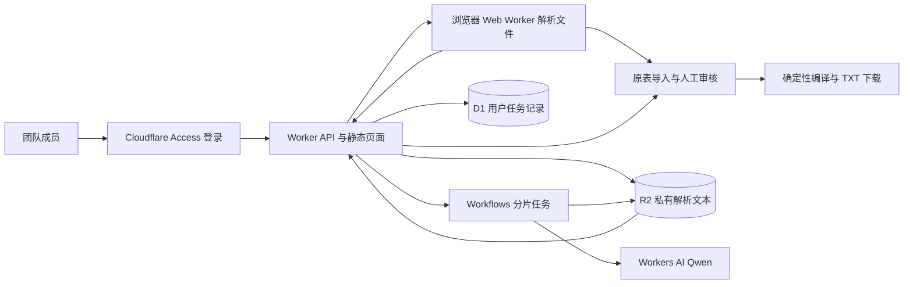

# 词准 · Glossary Studio

面向会议同屏翻译的团队术语工作台：上传资料，选择页码或工作表，生成候选词，人工审核后下载两份 TXT。原表已有译法优先，AI 建议单独标记。

## 固定导出规则

| 文件 | 字符上限 | 格式 |
| --- | ---: | --- |
| 热词清单 | 2048 | `重庆，Chongqing，Industrial Collaboration，产业协同` |
| 指定翻译 | 20480 | `Fuzhou High tech Industrial Development Zone-福州高新技术产业开发区，Industrial Collaboration-产业协同` |

- 两份文件都是单行 UTF-8 TXT，有 BOM 和一组结尾 CRLF。字符数按 JavaScript UTF-16 单元计算，**包含 BOM（1）和 CRLF（2）**。这不是 UTF-8 字节限制。
- 指定翻译每条恰好一个 ASCII `-`，中文逗号仅隔开完整映射。
- 原词、译文内部的 Unicode 连字符、破折号、负号、半角／全角逗号换为空格，合并空白；英文短语不会按空格拆开，中文词组不拆字。
- 超限按必保 → 人名 → 地名 → 机构 → 产品 → 行业术语 → 其他取舍，每类按重要度排序。只跳过完整条目，并显示原因；必保超限禁止下载。
- 相同原词的冲突译法隔离，需选择正确的一项；可选双向映射，逆向也检查冲突。两端相同的映射不导出。
- 斜杠别称保持原词组并标记审核，**不自动猜共享前后缀或交叉配对型号**。在审核表手动拆成完整词组后确认，例如 `Fire Resistant Fabric`、`Protective Fabric`。多条可使用“添加词条”。
- 模型必须提供连续原文摘录，代码验证原词和摘录确实存在。专名无原文对照时译文留空。普通术语的 AI 建议译法需勾选确认；未确认建议译文也不进入热词。
- 对照表导入保留用户所选列中的配对。未提供实际人名时不会自行补人名；表内已有歧义需人工核对。

## 架构选择

采用 **React + TypeScript + Vite / Cloudflare Workers Static Assets + Access + Workflows + D1 + R2 + Workers AI**。



Cloudflare Workers 可以同时托管前端静态资源与 API。本项目只部署一个全栈 Worker，仍在 Cloudflare 控制台的 **Workers & Pages** 下管理，避免两个部署入口、跨域和重复认证配置。GitHub 主分支通过 Workers Builds 自动构建部署。

- **Access**：成员邮箱白名单 + 邮箱一次性验证码，或接入公司 Google / Microsoft 身份系统。应用对所有路径验证 JWT 签名、issuer、audience 和有效期。生产默认拒绝未配置或未登录请求，禁用 `workers.dev` 与预览地址，避免绕过主域名入口。
- **Web Worker**：浏览器解析 PDF、XLSX、DOCX、TXT、CSV，不把复杂文件解析塞进 Cloudflare 请求 CPU。Excel 原表导入不调用 AI。
- **Workflows**：AI 在后台分片执行、有限重试和记录进度。每个片段失败后整项任务失败，不导出部分结果；关闭浏览器后可恢复任务。
- **D1**：按成员隔离任务查询。原子 SQL 限额：每成员每天 30 项、同时 2 项；整个团队每天 200 项，按过去 24 小时统计。防止并发提交绕过限额。
- **R2**：私有桶保存解析文本和结果，原始文件留在浏览器。成功后删除输入和中间结果；结果保留 7 天，每小时清理，成员可主动删除。Workflows 持久状态只返回数量和 R2 键，避免存入正文；Cloudflare 平台日志／元数据保留由账号设置控制。
- **AI**：默认 `@cf/qwen/qwen3.8-27b`，Cloudflare 托管的中英多语言模型，支持结构化输出，直接使用 AI binding，团队成员不用填写 API Key。模型名称由管理员服务端配置。模型提取与翻译质量需要部署后用实际会议文件评估；确定性代码负责最终格式和上限。

## 运行

需要 Node.js 22.12+（或 24）与 npm。

```powershell
npm ci
Copy-Item .dev.vars.example .dev.vars
npm run db:local
npm run dev
```

打开终端给出的 `http://127.0.0.1:5173`。本地开发身份绕过必须同时满足 `AUTH_MODE=local` 与 localhost URL，无法用于公开域名。原表导入、编辑、限长和下载可在没有 AI 账号时运行。开发默认关闭远端 binding；真正 AI 请求需要 Cloudflare 账号与可用额度，执行 `npx wrangler login` 后，PowerShell 设置 `$env:CF_AI_REMOTE = '1'`，再运行 `npm run dev`。生产部署始终使用实际 binding，此开关只控制本地开发。

```powershell
npm run check
```

测试覆盖格式回归、UTF-16/BOM/CRLF 边界、专名优先、必保超限、双向冲突、完整分片、模型证据、伪造身份、JWT 签名/应用/到期和跨站请求。

## 上传与审核

1. 上传资料，选择项目名称和参与处理的内容。可取消 PDF 页或 Excel 工作表。
2. 对已有双语表选择原词列、译文列、是否跳过每表首行，点击“按原表导入”；普通资料点击“AI 提取候选词”。
3. 核对原文出处，修改词条、类别、重要度，勾选热词与指定翻译。勾选指定翻译表示人工确认。必保项可能消耗较多字符预算。
4. 检查“未纳入”原因、格式调整以及两份预览，再下载 TXT。AI 初次提取的候选表仍需人工审阅。
5. 保存 JSON 审核项目，便于继续修改或交给其他成员导入。JSON 可能包含客户词条和证据，保存到客户资料目录，不要提交仓库。当前版本不提供多人实时共同编辑，云端任务对创建者可见。

## 文件与产品边界

- 单文件 20 MB，PDF 80 页，最多 80 个解析片段；所选 AI 文本最多 120000 字符。超过范围明确报错，需选择部分页面或拆分，不会偷偷截断正文。
- XLSX / CSV 每表最多 5000 行、XLSX 100 列；ZIP 解压前检查展开尺寸，最大合计 60 MB。只读缓存公式值，不重新计算 Excel 公式。
- 文字型 PDF 支持；**扫描 PDF / 图片 OCR 暂未实现**。无文字页面会明确提示。加密、损坏、复杂版面文件可能需要先转成文字 PDF / TXT，阅读所选原文预览确认顺序。
- DOCX 读取正文、脚注、尾注和页眉页脚，图片和图表里的文字不识别。TXT 支持 UTF-8 或 GB18030。
- 本版每次一个文件。多份资料可分别处理后在同一 JSON 项目里继续整理；尚未提供批量合并按钮。
- 规则化字符限制保证 TXT 格式；实际使用的同屏翻译软件仍需做一次真实导入验证。
- 全球域名提供入口，具体地区网络可达性由网络条件决定；全球部署不等于每个地区都稳定可达。

## GitHub → Cloudflare → 域名

详细步骤见 [DEPLOY.md](DEPLOY.md)。仓库只应包含代码、测试、合成演示和配置。没有真实客户文档、上传文件、API Key 或账号凭据。

本地检查结果与未验证事项见 [VALIDATION.md](VALIDATION.md)。格式演示文件见 `samples/双语术语示例.csv`。

## 官方依据

核对日期：2026-11-10。

- [Workers Static Assets](https://developers.cloudflare.com/workers/static-assets/)
- [Workers Builds / Git 集成](https://developers.cloudflare.com/workers/ci-cd/builds/)
- [Access JWT 校验](https://developers.cloudflare.com/cloudflare-one/access-controls/applications/http-apps/authorization-cookie/validating-json/)
- [Workflows API](https://developers.cloudflare.com/workflows/build/workers-api/)
- [Workers AI Qwen 3.8 27B](https://developers.cloudflare.com/workers-ai/models/qwen3.8-27b/)
- [Workers AI JSON Mode](https://developers.cloudflare.com/workers-ai/features/json-mode/)

依赖以 package-lock.json 锁定，部署时不靠“latest”漂移。模型和平台价格以实际账号控制台为准。
