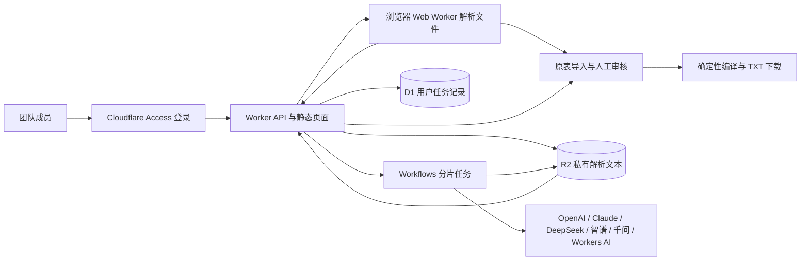

# HotWord · 会议术语工作台

面向会议同屏翻译的团队术语工作台：上传资料，选择页码或工作表，自动补全和复核指定翻译，集中核对疑点后下载两份 TXT。原表已有译法优先，AI 复核通过的标准译法自动纳入，其余建议可批量采用。

本项目位于 `C:\Users\杨烜曦\Desktop\HotWord`，使用该目录原有 Git 仓库及 `origin`：`https://github.com/xuanxi369/HotWord.git`。

界面参考 recent.design 的留白、胶囊组件与细腻反馈，采用 Motion 弹簧动效及 Radix 可访问组件。具体参考、交互映射与验证记录见 [设计说明](docs/design.md)。

## 多语对照入口

顶部左侧新增“多语对照”，页面地址为 `/multilingual`；“会议词库”主页面仍位于 `/`，继续使用原有中英处理逻辑。两个页面沿用现有样式和准备资料、核对词条、下载词库三步布局，切换页面时各自保留当前草稿，主题和模型配置共享。

新页面提供 18 种语言选项：中文、英语、德语、阿拉伯语、日语、韩语、法语、西班牙语、意大利语、葡萄牙语、俄语、土耳其语、泰语、越南语、印尼语、印地语、波斯语和希伯来语。选择不同的原文语言与译文语言即可建立对应方向，也可交换两端；导出时仍可选择生成双向映射。

- 每次上传一个文件，格式和读取范围与主页面一致。已有双语表按所选两种语言识别列，原表译法优先；多语言表只使用所选语言列，方向与页面选择一致。未识别表头时可手动核对列及预览。
- 单语资料、单语表格或缺少完整对应译法的资料使用 AI 提取、补全和独立复核。提取、分类核对和再次补全均使用提交时固定的语言组合；未知人名和无可靠依据的译法保留待核对原因。
- 阿拉伯语等从右向左书写的词条在审核和预览中按文字方向显示。显示方向不改变 TXT 内原词与译文的顺序；两份 TXT 继续使用下方固定格式、字符限制、完整条目取舍和冲突检查规则，分隔条目的仍是中文逗号 `，`。
- 新页面保存 version 2 审核 JSON，包含语言组合及双向映射设置；导入后自动进入多语对照页面恢复。主页面继续保存原格式的 version 1，旧 JSON 仍按主页面规则恢复。近期任务也保留语言组合，后台输入删除后仍可正确恢复结果。
- 发布此功能前须应用新增数据库迁移 `migrations/0003_language_pair.sql`，再发布依赖该字段的代码。它只新增可为空的任务语言列，已有任务继续按原流程处理；网页应用与迁移登记步骤见 [DEPLOY.md](DEPLOY.md)。

## 固定导出规则

| 文件 | 字符上限 | 格式 |
| --- | ---: | --- |
| 热词清单 | 2048 | `重庆，Chongqing，Industrial Collaboration，产业协同` |
| 指定翻译 | 20480 | `Fuzhou High tech Industrial Development Zone-福州高新技术产业开发区，Industrial Collaboration-产业协同` |

- 两份文件都是单行 UTF-8 TXT，有 BOM 和一组结尾 CRLF。字符数按 JavaScript UTF-16 单元计算，**包含 BOM（1）和 CRLF（2）**。这不是 UTF-8 字节限制。
- 指定翻译每条恰好一个 ASCII `-`，中文逗号仅隔开完整映射。
- 原词、译文内部的 Unicode 连字符、破折号、负号、半角／全角逗号换为空格，合并空白；英文短语不会按空格拆开，中文词组不拆字。
- 超限按必保 → 人名 → 地名 → 机构 → 产品 → 行业术语 → 其他取舍，每类按重要度排序。只跳过完整条目，并显示原因；必保超限禁止下载。
- 相同原词的冲突译法隔离，需选择正确的一项；可选双向映射，逆向也检查冲突。两端相同的映射不导出。
- 斜杠别称保持原词组并标记审核，**不自动猜共享前后缀或交叉配对型号**。在审核表手动拆成完整词组后确认，例如 `Fire Resistant Fabric`、`Protective Fabric`。多条可使用“添加词条”。
- 模型必须提供连续原文摘录，代码验证原词和摘录确实存在；中英译法分处不同段落时单独验证目标摘录。文档提取后自动补全缺失译法并独立复核，通行标准译法通过后直接纳入指定翻译。无依据的未知姓名不猜中文名或拼音，保留缺少依据的具体原因。未采用的建议译文也不进入热词。
- 已有审核结果可点击“AI 补全指定翻译”，保留原词、已有译文、出处与热词选择；“批量采用建议”一次采用完整、无冲突的对应译法，并支持撤销。界面区分已采用、AI 核对通过、建议待采用与缺少译名，避免把大量空译文误当成字数预算问题。新增调用继续计入实际用量。
- 顶部月亮/太阳按钮切换暗夜/明亮模式；暗夜采用炭黑底色、紫灰光晕、淡紫强调和柔白主按钮，列表、导出和弹窗统一配色。主题偏好保存在本机，首屏加载前读取以避免白屏闪烁。第一次使用参考系统主题，手动切换后记住选择。
- 对照表优先选择专用双语导入表；没有专用表时选择识别到双语表头的工作表。自动模式按每张表分别识别原词列、译文列及表头位置，也支持关闭自动模式后手动选列。无表头的简单双列表默认保留第一条术语。
- 导入、模型结果及最终导出均检查明显的非术语内容，排除独立数字、序号、日期、说明标签、占位、操作指令和明显的宣传句。使用说明和错误译法表不作为正式术语导入；旧审核项目也执行导出检查。带数字的完整技术名称、缩写和长技术词组继续保留。规则无法代替人工语义审核。
- 合法原词的译文如果是说明或占位，仅保留原词作为热词；必保项含非术语内容时明确报错并禁止相应文件下载。未提供实际人名时不会自行补人名；表内已有歧义需人工核对。
- 通用双语表的分类参考姓名表头、分类列、合并分类标题、双语姓名拼写与邻近行。支持连续外籍名单、中间名、括号别名，机构和包含人名的奖项按整个词条分类。中文/英文表头按每张表原有左右方向导入，英译中表不倒置。类别计数表示词条数，同一人的正反向映射分别保留。
- 双语表可选择“原表 + AI 分类”；已有审核项目也能点击“AI 分类核对”。内置提示词区分个人、地名、机构、产品/药品、专业术语与职务/奖项，并提示具体易误译风险。AI 只返回逐条 ID 的分类、重要度与依据，原词、译文、出处和导出选择由代码保留。少任何 ID 或输出不完整时按完整行拆分，未知/重复 ID 拒绝。类别不确定或与机构证据冲突时保留原分类并标记待核对。无需逐份重写提示词，仍需核对模型提出的疑点。
- 审核表每行分别显示热词与指定翻译的实际结果：已纳入、已去重纳入、部分纳入、未导出、待确认或未选择。点击状态查看对应文件的预算、冲突或内容检查原因。“导出受限”仅筛选实际受限词条，不表示识别失败；所有识别词条继续保留。旧 JSON 保持兼容，可直接 AI 核对原有词条。

## 架构选择

采用 **React + TypeScript + Vite / Cloudflare Workers Static Assets + Access + Workflows + D1 + R2 + 多服务商适配层**。支持团队统一服务和个人 API Key，配置见 [模型与密钥说明](docs/api-services.md)。



Cloudflare Workers 可以同时托管前端静态资源与 API。本项目只部署一个全栈 Worker，仍在 Cloudflare 控制台的 **Workers & Pages** 下管理，避免两个部署入口、跨域和重复认证配置。GitHub 主分支通过 Workers Builds 自动构建部署。

- **Access**：成员邮箱白名单 + 邮箱一次性验证码，或接入公司 Google / Microsoft 身份系统。应用对所有路径验证 JWT 签名、issuer、audience 和有效期。生产默认拒绝未配置或未登录请求，禁用 `workers.dev` 与预览地址，避免绕过主域名入口。
- **Web Worker**：浏览器解析 PDF、XLSX、DOCX、TXT、CSV，不把复杂文件解析塞进 Cloudflare 请求 CPU。Excel 原表导入不调用 AI。
- **Workflows**：AI 在后台按模型单次容量和行数分片，记录进度。输出截断或模型声明词条未提取完整时，继续二分直到子片段完整输出，每部分可独立重试一次连接。最小片段仍失败则整项任务失败，不导出部分结果。关闭浏览器后可恢复任务。
- **D1**：按成员隔离任务和凭据。每日任务数、Token 用量和金额不限，旧额度设置自动停用；保留每成员同时 2 项的原子并发保护。用量和准入记录保留 30 天，删除任务不删除历史用量。
- **R2**：私有桶保存解析文本和结果，原始文件留在浏览器。成功后删除输入和中间结果；结果保留 7 天，每小时清理，成员可主动删除。Workflows 持久状态只返回数量和 R2 键，避免存入正文；Cloudflare 平台日志／元数据保留由账号设置控制。
- **AI**：后台可统一配置五家 Secrets，并管理开放模型和计价信息；保留原有 Workers AI 默认服务。提取全部符合条件的词条，不设置候选条数上限。个人入口支持测试、保存自己的密钥，默认仅用于一次任务，可主动记住。AES-256-GCM 加密，任务独立快照，完成 / 失败 / 取消后删除任务密钥。所有模型继续验证原文依据并进入人工审核，失败不自动换密钥；确定性代码负责最终格式和上限。

## 运行

需要 Node.js 22.12+（或 24）与 npm。

```powershell
npm ci
Copy-Item .dev.vars.example .dev.vars
npm run db:local
npm run dev
```

打开终端给出的 `http://127.0.0.1:5173`。本地开发身份绕过必须同时满足 `AUTH_MODE=local` 与 localhost URL，无法用于公开域名。原表导入、编辑、限长和下载可在没有 AI 账号时运行。开发默认关闭远端 binding；原有 Workers AI binding 的真实调用需要 Cloudflare 账号与可用额度，执行 `npx wrangler login` 后，PowerShell 设置 `$env:CF_AI_REMOTE = '1'`，再运行 `npm run dev`。生产部署始终使用实际 binding，此开关只控制本地开发。

```powershell
npm run check
```

测试覆盖格式回归、UTF-16/BOM/CRLF 边界、专名优先、必保超限、双向冲突、完整分片、模型证据、伪造身份、JWT 签名/应用/到期和跨站请求。

个人密钥本地使用前，请在被 Git 忽略的 .dev.vars 中配置 CREDENTIAL_ENCRYPTION_KEY（随机 32 字节的 Base64）；外部五家 API 调用使用自己的有效密钥与相应服务商额度，配置步骤见 [模型与密钥说明](docs/api-services.md)。

## 上传与审核

1. 上传资料，选择项目名称和参与处理的内容。可取消 PDF 页或 Excel 工作表。
2. 对已有双语表核对推荐工作表、术语列和词条预览，点击“导入并核对”。自动模式会跳过表头及其前面的标题；必要时关闭自动识别后手动调整。普通资料点击“开始提取”。
3. AI 复核通过的指定翻译自动采用；已有项目可点击“AI 补全指定翻译”，剩余建议支持批量采用和撤销。集中核对有疑点的词条，需要时修改类别、重要度或手动勾选。必保项可能消耗较多字符预算。
4. 检查“未纳入”原因、格式调整以及两份预览，再下载 TXT。AI 初次提取的候选表仍需人工审阅。
5. 保存 JSON 审核项目，便于继续修改或交给其他成员导入。JSON 可能包含客户词条和证据，保存到客户资料目录，不要提交仓库。当前版本不提供多人实时共同编辑，云端任务对创建者可见。

## 文件与产品边界

- 单文件 20 MB，PDF 80 页，最多 80 个解析片段；所选 AI 文本最多 120000 字符。超过范围明确报错，需选择部分页面或拆分，不会偷偷截断正文。
- XLSX / CSV 每表最多 5000 行、XLSX 100 列；ZIP 解压前检查展开尺寸，最大合计 60 MB。只读缓存公式值，不重新计算 Excel 公式。
- 文字型 PDF 支持；**扫描 PDF / 图片 OCR 暂未实现**。无文字页面会明确提示。加密、损坏、复杂版面文件可能需要先转成文字 PDF / TXT，阅读所选原文预览确认顺序。
- DOCX 读取正文、脚注、尾注和页眉页脚，图片和图表里的文字不识别。TXT 支持 UTF-8 或 GB18030。
- 本版每次一个文件。多份资料可分别处理后在同一 JSON 项目里继续整理；尚未提供批量合并按钮。
- 规则化字符限制保证 TXT 格式；实际使用的同屏翻译软件仍需做一次真实导入验证。
- 全球域名提供入口，具体地区网络可达性由网络条件决定；全球部署不等于每个地区都稳定可达。

## GitHub → Cloudflare → 域名

部署方式以 **Cloudflare 网页仪表盘连接 GitHub、使用 Workers Builds** 为准，个人电脑无需运行部署命令；完整网页步骤见 [DEPLOY.md](DEPLOY.md)。仓库只应包含代码、测试、合成演示和配置。没有真实客户文档、上传文件、API Key 或账号凭据。

本地检查结果与未验证事项见 [VALIDATION.md](VALIDATION.md)。格式演示文件见 `samples/双语术语示例.csv`。

## 官方依据

核对日期：2026-11-10。

- [Workers Static Assets](https://developers.cloudflare.com/workers/static-assets/)
- [Workers Builds / Git 集成](https://developers.cloudflare.com/workers/ci-cd/builds/)
- [Access JWT 校验](https://developers.cloudflare.com/cloudflare-one/access-controls/applications/http-apps/authorization-cookie/validating-json/)
- [Workflows API](https://developers.cloudflare.com/workflows/build/workers-api/)
- [Workers AI Qwen 3.8 27B](https://developers.cloudflare.com/workers-ai/models/qwen3.8-27b/)
- [Workers AI JSON Mode](https://developers.cloudflare.com/workers-ai/features/json-mode/)

依赖以 package-lock.json 锁定，部署时不靠“latest”漂移。模型和平台价格以实际账号控制台为准。
